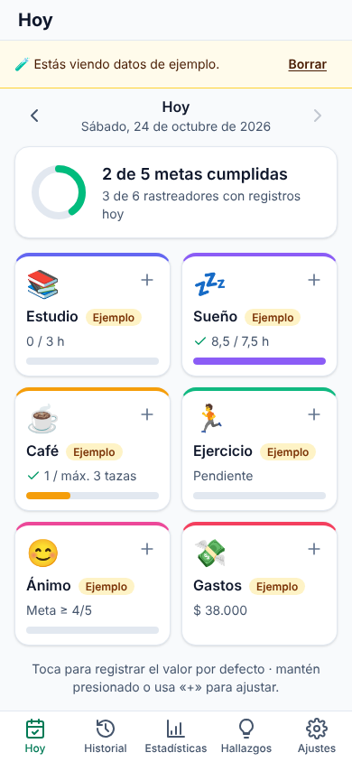
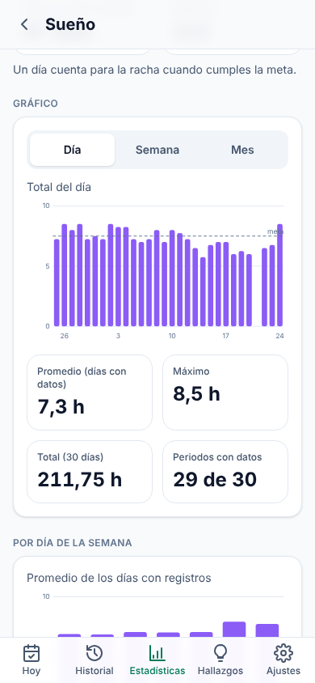
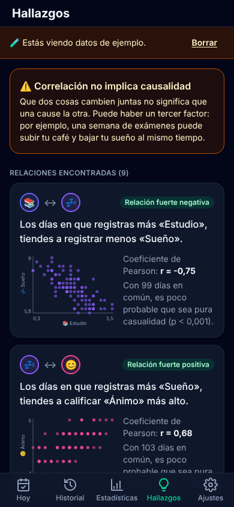
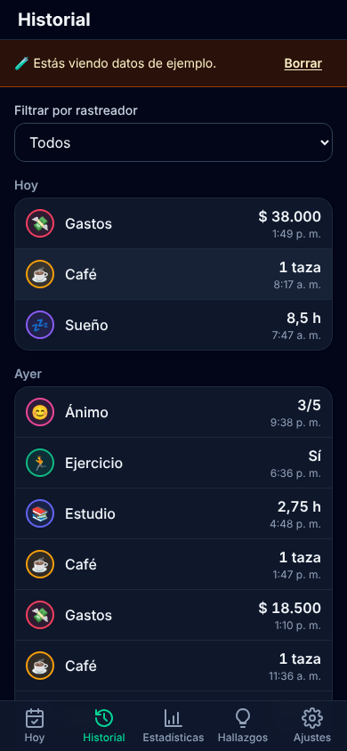

# Pulso

**Pulso** es una app web progresiva (PWA) para registrar tu vida como si fuera un dataset: horas de estudio, sueño, gastos, café, ejercicio, ánimo o lo que quieras medir. Registrar algo toma un toque, y la app convierte esos registros en hallazgos honestos sobre tus hábitos.

- 📱 Pensada primero para celular, instalable en Android y con funcionamiento sin conexión.
- 🔒 Tus datos viven solo en tu dispositivo (IndexedDB). Sin cuentas, sin telemetría, sin servidores.
- 🇨🇴 Interfaz en español de Colombia: fechas, números y pesos colombianos (COP).

  
  
  
  

## Funciones

**Registrar**

- **Rastreadores a tu medida:** contador, cantidad con unidad (horas, km, COP…), sí/no o escala 1–5, con ícono, color y meta diaria opcional: «al menos» (8 vasos de agua) o «como máximo» (3 tazas de café). Se pueden editar, archivar y ordenar arrastrando. Hay 12 plantillas comunes.
- **Un toque:** toca un rastreador en «Hoy» para registrar su valor por defecto; mantén presionado (o usa «+») para ajustar valor, fecha, hora y nota. Todo se puede deshacer.
- **Días anteriores:** flechas para moverte de día y registrar lo que olvidaste.
- **Recordatorio diario** opcional dentro de la app.

**Entender**

- **Hoy:** progreso frente a cada meta y resumen de metas cumplidas.
- **Historial:** registros por día, con filtro, edición y borrado.
- **Estadísticas:** resumen de la semana o el mes frente al anterior (mismos días), rachas, calendario anual estilo GitHub (tocable), gráficos por día/semana/mes y promedio por día de la semana.
- **Hallazgos:** correlaciones de Pearson entre rastreadores (mínimo 14 días en común), también con un día de desfase, explicadas en lenguaje simple, con valor p, diagrama de dispersión y la advertencia de que correlación no implica causalidad.

**Tus datos**

- **CSV** en formato largo (`fecha, hora, rastreador, valor, unidad, nota`) para exportar e importar con validación por línea, y CSV ancho (un día por fila) para análisis.
- **Respaldo completo en JSON** para cambiar de celular, con recordatorio si llevas un mes sin respaldar.
- **Datos de ejemplo** para explorar, marcados y borrables con un botón.

**Calidad**

- Modo claro/oscuro, accesible con teclado y lector de pantalla (probado con axe), respeta «reducir movimiento».
- ~200 pruebas automáticas; lint, tipos, pruebas y build en cada push.

## Cómo ejecutarlo

Toda la guía paso a paso (Docker, Node, pruebas, despliegue e instalación en Android) está en [`COMO_EJECUTAR.md`](COMO_EJECUTAR.md). El avance está en [`ROADMAP.md`](ROADMAP.md) y las decisiones en [`BITACORA.md`](BITACORA.md).
